# Walkthrough

A step-by-step demonstration of both tasks running for real. Every request goes to the running Docker stack, with a real `database` queue and worker. The screenshots and responses below are captured output, not mock-ups. For the design and the automated tests, see [SOLUTION.md](SOLUTION.md).

- **Task 1** (steps 1–6) was driven from Chrome through Playwright. Each response is shown pretty-printed, with the bearer token redacted.
- **Task 2** (steps 7–12) runs in the terminal, because it is a scheduled command and a queue worker. Step 12 then checks the result through the Task 1 API.

No real B2B request is sent anywhere. `NBN_B2B_ENDPOINT` points at a tiny local server that replies with the two stub files in `tests/stubs/`. It returns the fail stub when `address_1` starts with `FAIL`, and the success stub otherwise.

## Demo data

Eighteen applications, seeded into the local SQLite database. The ids start at 42 only because the local database had been used before.

| Customer | Plan | Status | Created | Why it is there |
| --- | --- | --- | --- | --- |
| Jane Citizen | nbn | `order` | oldest | should be ordered successfully |
| Cher (no last name) | nbn | `order` | | address starts with `FAIL`, so the order fails |
| Bruce Wayne | nbn | `order` | | should be ordered successfully |
| Ada Lovelace | nbn | `complete`, `ORD-EARLIER` | | the only row that should show `order_id` before ordering |
| Alan Turing | nbn | `prelim` | | nbn, but not awaiting order |
| Grace Hopper | mobile | `order` | | awaiting order, but not nbn |
| Linus Torvalds | opticomm | `order` | | awaiting order, but not nbn |
| 11 filler rows | mixed | `prelim` | newest | make a second page |

Plan prices are stored in cents: nbn `8999`, mobile `500`, opticomm `123456`.

Responses with many items are trimmed to the first few, marked `// … N more items omitted here …`. Everything else in each response is shown exactly as returned.

---

## Task 1 · `GET /api/applications`

### Step 1 · No login token → 401, not a crash

A plain browser visit, with no token and no `Accept: application/json` header. Before a fix made after an earlier run of this walkthrough, this returned a **500**: Laravel tried to redirect the guest to a `login` route that this API-only app does not have. It now returns a JSON 401. The regression test is `test_guests_get_a_json_401_even_without_a_json_accept_header`.

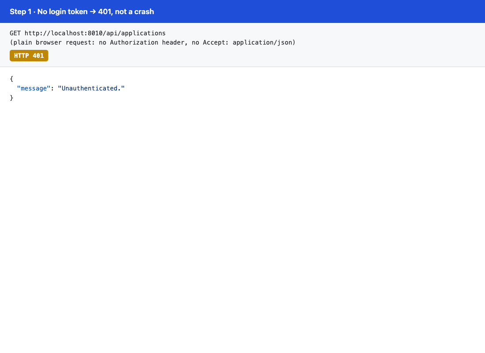

```json
{
  "message": "Unauthenticated."
}
```

### Step 2 · Logged in: page 1, oldest first

What this shows:

- Pagination: 15 of 18 on page 1, with `next` pointing at page 2.
- Oldest first: Jane, created 100 days ago, is at the top.
- Only the agreed fields are returned.
- A full name with no last name reads cleanly ("Cher", no trailing space).
- Cents are shown as dollars (`8999` → `$89.99`).
- No `order_id` key appears on applications that are not `complete`.

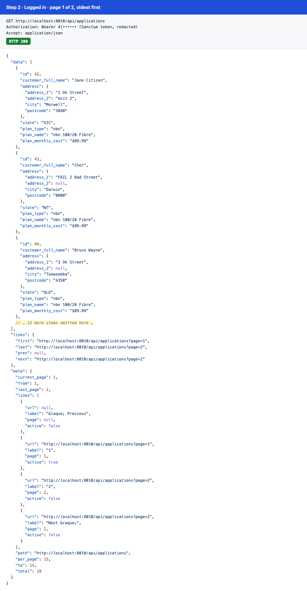

<details><summary>Response</summary>

```jsonc
{
  "data": [
    {
      "id": 42,
      "customer_full_name": "Jane Citizen",
      "address": {
        "address_1": "1 Ok Street",
        "address_2": "Unit 2",
        "city": "Morwell",
        "postcode": "3840"
      },
      "state": "VIC",
      "plan_type": "nbn",
      "plan_name": "nbn 100/20 Fibre",
      "plan_monthly_cost": "$89.99"
    },
    {
      "id": 43,
      "customer_full_name": "Cher",
      "address": {
        "address_1": "FAIL 2 Bad Street",
        "address_2": null,
        "city": "Darwin",
        "postcode": "0800"
      },
      "state": "NT",
      "plan_type": "nbn",
      "plan_name": "nbn 100/20 Fibre",
      "plan_monthly_cost": "$89.99"
    },
    {
      "id": 44,
      "customer_full_name": "Bruce Wayne",
      "address": {
        "address_1": "3 Ok Street",
        "address_2": null,
        "city": "Toowoomba",
        "postcode": "4350"
      },
      "state": "QLD",
      "plan_type": "nbn",
      "plan_name": "nbn 100/20 Fibre",
      "plan_monthly_cost": "$89.99"
    },
    // … 12 more items omitted here …
  ],
  "links": {
    "first": "http://localhost:8010/api/applications?page=1",
    "last": "http://localhost:8010/api/applications?page=2",
    "prev": null,
    "next": "http://localhost:8010/api/applications?page=2"
  },
  "meta": {
    "current_page": 1,
    "from": 1,
    "last_page": 2,
    "links": [
      { "url": null, "label": "&laquo; Previous", "page": null, "active": false },
      { "url": "http://localhost:8010/api/applications?page=1", "label": "1", "page": 1, "active": true },
      { "url": "http://localhost:8010/api/applications?page=2", "label": "2", "page": 2, "active": false },
      { "url": "http://localhost:8010/api/applications?page=2", "label": "Next &raquo;", "page": 2, "active": false }
    ],
    "path": "http://localhost:8010/api/applications",
    "per_page": 15,
    "to": 15,
    "total": 18
  }
}
```

</details>

### Step 3 · Page 2 holds the remaining 3

Items 16–18, which are the newest. The mobile and opticomm rows show `$5.00` and `$1,234.56`, confirming the thousands separator.

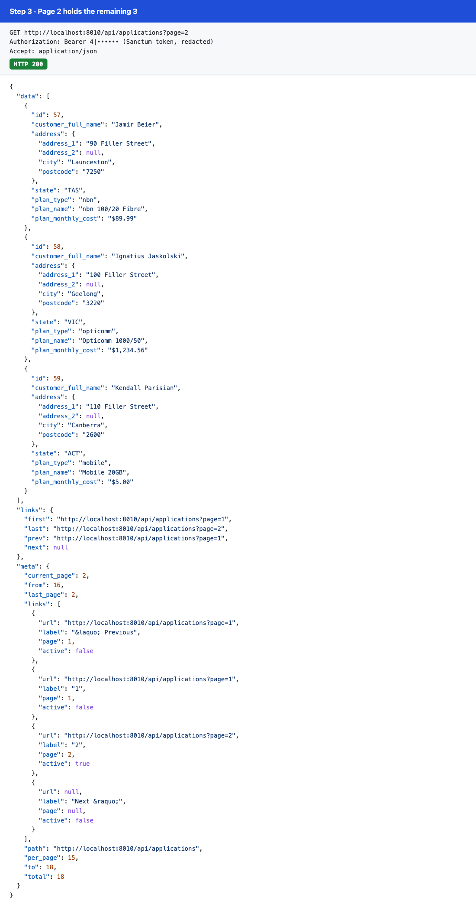

<details><summary>Response</summary>

```json
{
  "data": [
    {
      "id": 57,
      "customer_full_name": "Jamir Beier",
      "address": {
        "address_1": "90 Filler Street",
        "address_2": null,
        "city": "Launceston",
        "postcode": "7250"
      },
      "state": "TAS",
      "plan_type": "nbn",
      "plan_name": "nbn 100/20 Fibre",
      "plan_monthly_cost": "$89.99"
    },
    {
      "id": 58,
      "customer_full_name": "Ignatius Jaskolski",
      "address": {
        "address_1": "100 Filler Street",
        "address_2": null,
        "city": "Geelong",
        "postcode": "3220"
      },
      "state": "VIC",
      "plan_type": "opticomm",
      "plan_name": "Opticomm 1000/50",
      "plan_monthly_cost": "$1,234.56"
    },
    {
      "id": 59,
      "customer_full_name": "Kendall Parisian",
      "address": {
        "address_1": "110 Filler Street",
        "address_2": null,
        "city": "Canberra",
        "postcode": "2600"
      },
      "state": "ACT",
      "plan_type": "mobile",
      "plan_name": "Mobile 20GB",
      "plan_monthly_cost": "$5.00"
    }
  ],
  "links": {
    "first": "http://localhost:8010/api/applications?page=1",
    "last": "http://localhost:8010/api/applications?page=2",
    "prev": "http://localhost:8010/api/applications?page=1",
    "next": null
  },
  "meta": {
    "current_page": 2,
    "from": 16,
    "last_page": 2,
    "links": [
      { "url": "http://localhost:8010/api/applications?page=1", "label": "&laquo; Previous", "page": 1, "active": false },
      { "url": "http://localhost:8010/api/applications?page=1", "label": "1", "page": 1, "active": false },
      { "url": "http://localhost:8010/api/applications?page=2", "label": "2", "page": 2, "active": true },
      { "url": null, "label": "Next &raquo;", "page": null, "active": false }
    ],
    "path": "http://localhost:8010/api/applications",
    "per_page": 15,
    "to": 18,
    "total": 18
  }
}
```

</details>

### Step 4 · Filter `plan_type=nbn`

8 applications, all nbn. Ada is the only `complete` one, so she is the only one with `order_id`. The pagination links keep `plan_type=nbn`, so paging a filtered list stays filtered.

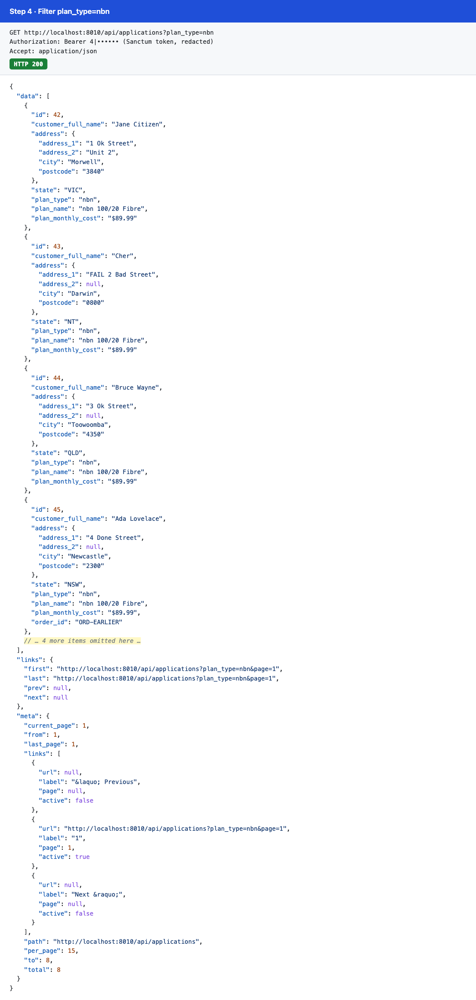

<details><summary>Response</summary>

```jsonc
{
  "data": [
    {
      "id": 42,
      "customer_full_name": "Jane Citizen",
      "address": { "address_1": "1 Ok Street", "address_2": "Unit 2", "city": "Morwell", "postcode": "3840" },
      "state": "VIC",
      "plan_type": "nbn",
      "plan_name": "nbn 100/20 Fibre",
      "plan_monthly_cost": "$89.99"
    },
    {
      "id": 43,
      "customer_full_name": "Cher",
      "address": { "address_1": "FAIL 2 Bad Street", "address_2": null, "city": "Darwin", "postcode": "0800" },
      "state": "NT",
      "plan_type": "nbn",
      "plan_name": "nbn 100/20 Fibre",
      "plan_monthly_cost": "$89.99"
    },
    {
      "id": 44,
      "customer_full_name": "Bruce Wayne",
      "address": { "address_1": "3 Ok Street", "address_2": null, "city": "Toowoomba", "postcode": "4350" },
      "state": "QLD",
      "plan_type": "nbn",
      "plan_name": "nbn 100/20 Fibre",
      "plan_monthly_cost": "$89.99"
    },
    {
      "id": 45,
      "customer_full_name": "Ada Lovelace",
      "address": { "address_1": "4 Done Street", "address_2": null, "city": "Newcastle", "postcode": "2300" },
      "state": "NSW",
      "plan_type": "nbn",
      "plan_name": "nbn 100/20 Fibre",
      "plan_monthly_cost": "$89.99",
      "order_id": "ORD-EARLIER"
    },
    // … 4 more items omitted here …
  ],
  "links": {
    "first": "http://localhost:8010/api/applications?plan_type=nbn&page=1",
    "last": "http://localhost:8010/api/applications?plan_type=nbn&page=1",
    "prev": null,
    "next": null
  },
  "meta": {
    "current_page": 1,
    "from": 1,
    "last_page": 1,
    "links": [
      { "url": null, "label": "&laquo; Previous", "page": null, "active": false },
      { "url": "http://localhost:8010/api/applications?plan_type=nbn&page=1", "label": "1", "page": 1, "active": true },
      { "url": null, "label": "Next &raquo;", "page": null, "active": false }
    ],
    "path": "http://localhost:8010/api/applications",
    "per_page": 15,
    "to": 8,
    "total": 8
  }
}
```

</details>

### Step 5 · Filter `plan_type=mobile`

5 applications, all mobile, at `$5.00` (stored as `500` cents).

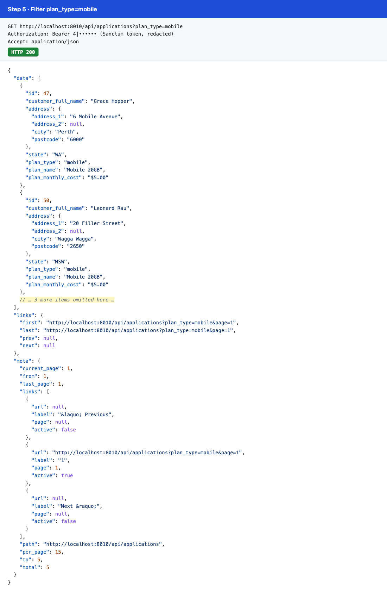

<details><summary>Response</summary>

```jsonc
{
  "data": [
    {
      "id": 47,
      "customer_full_name": "Grace Hopper",
      "address": { "address_1": "6 Mobile Avenue", "address_2": null, "city": "Perth", "postcode": "6000" },
      "state": "WA",
      "plan_type": "mobile",
      "plan_name": "Mobile 20GB",
      "plan_monthly_cost": "$5.00"
    },
    {
      "id": 50,
      "customer_full_name": "Leonard Rau",
      "address": { "address_1": "20 Filler Street", "address_2": null, "city": "Wagga Wagga", "postcode": "2650" },
      "state": "NSW",
      "plan_type": "mobile",
      "plan_name": "Mobile 20GB",
      "plan_monthly_cost": "$5.00"
    },
    // … 3 more items omitted here …
  ],
  "links": {
    "first": "http://localhost:8010/api/applications?plan_type=mobile&page=1",
    "last": "http://localhost:8010/api/applications?plan_type=mobile&page=1",
    "prev": null,
    "next": null
  },
  "meta": {
    "current_page": 1,
    "from": 1,
    "last_page": 1,
    "links": [
      { "url": null, "label": "&laquo; Previous", "page": null, "active": false },
      { "url": "http://localhost:8010/api/applications?plan_type=mobile&page=1", "label": "1", "page": 1, "active": true },
      { "url": null, "label": "Next &raquo;", "page": null, "active": false }
    ],
    "path": "http://localhost:8010/api/applications",
    "per_page": 15,
    "to": 5,
    "total": 5
  }
}
```

</details>

### Step 6 · Unknown plan type → 422

A typo is rejected rather than silently treated as "all".

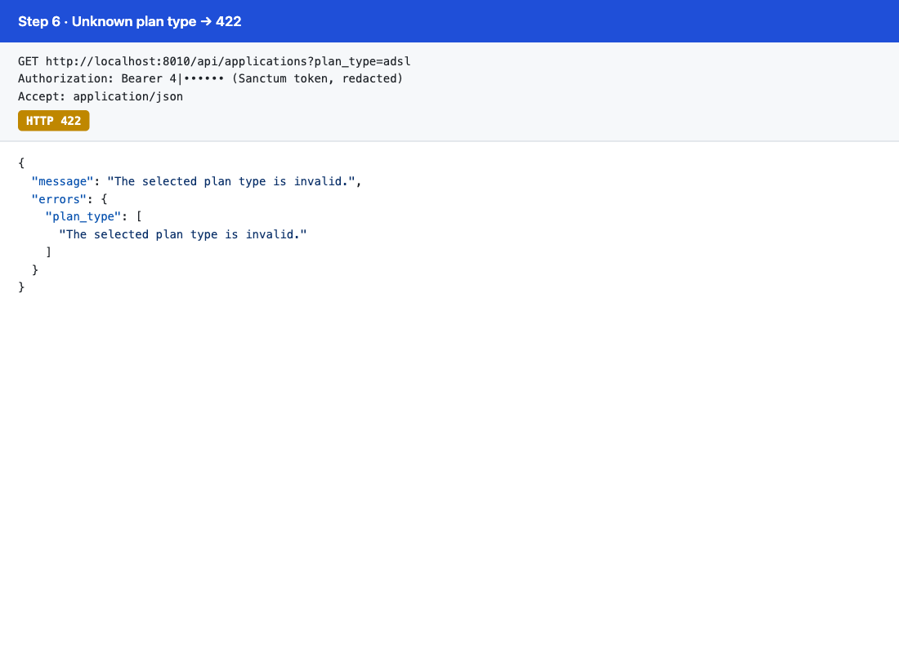

```json
{
  "message": "The selected plan type is invalid.",
  "errors": {
    "plan_type": [
      "The selected plan type is invalid."
    ]
  }
}
```

---

## Task 2 · automated nbn ordering

### Step 7 · Before

Three nbn applications are waiting in `order`. Ada is already `complete`. The mobile and opticomm applications are also in `order`, but they are not nbn.

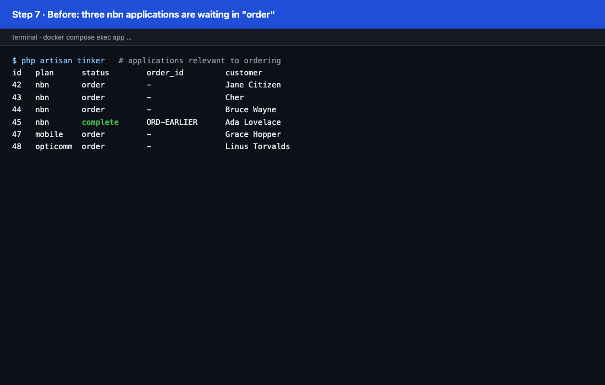

### Step 8 · Scheduled every five minutes

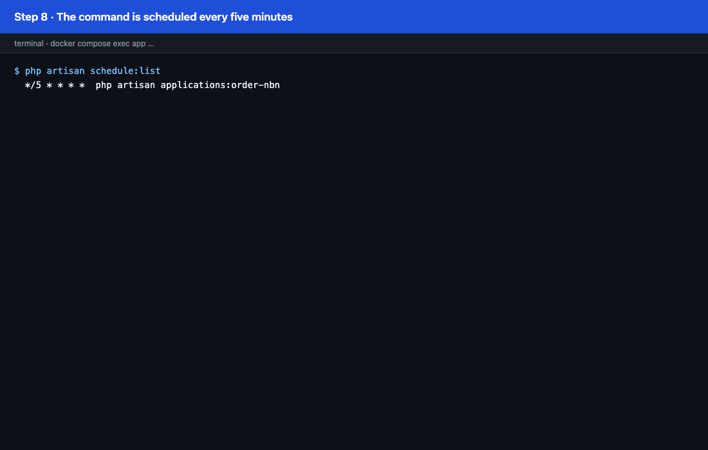

```
$ php artisan schedule:list
  */5 * * * *  php artisan applications:order-nbn
```

### Step 9 · The scheduler fires twice before a worker runs

This simulates a backlog: two five-minute runs before any worker has picked up a job. Both runs find the same 3 applications, but only **3** jobs are queued, not 6, because `OrderNbnApplication` is unique per application. No application can be ordered twice.

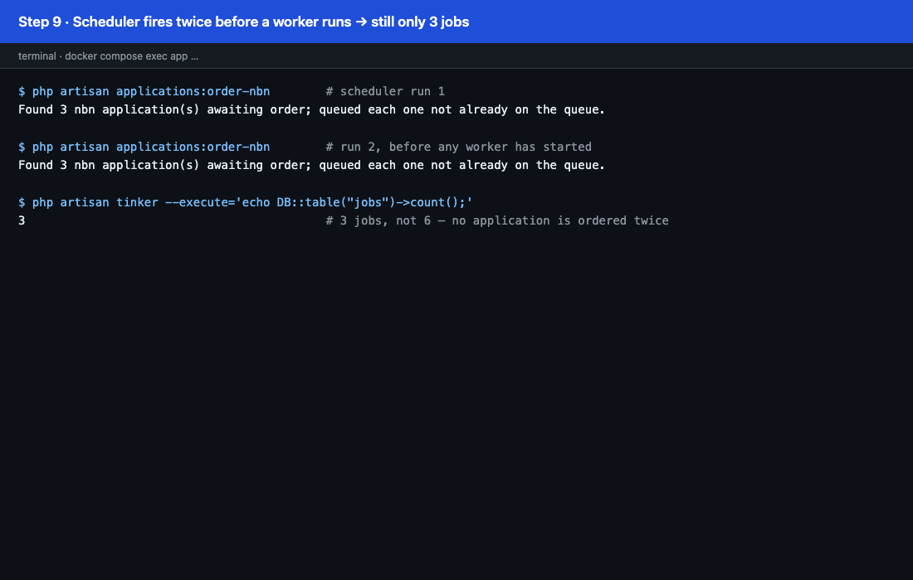

### Step 10 · Endpoint not configured

With `NBN_B2B_ENDPOINT` empty, the command refuses to queue anything and exits `1`. Without this guard, a missing environment variable would push every nbn application to `order failed` within five minutes.

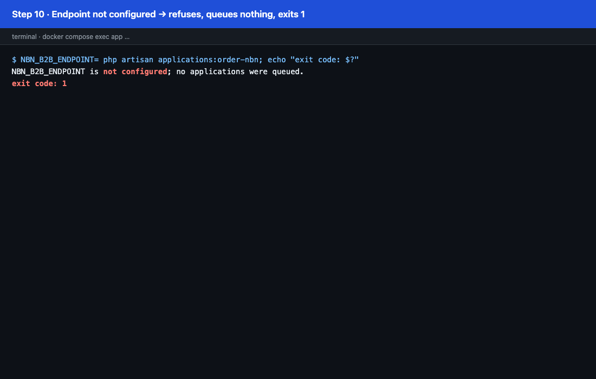

```
$ NBN_B2B_ENDPOINT= php artisan applications:order-nbn; echo "exit code: $?"
NBN_B2B_ENDPOINT is not configured; no applications were queued.
exit code: 1
```

### Step 11 · The worker places the orders

The worker runs the 3 jobs:

- **Jane and Bruce** get the success stub. `order_id` is stored (`ORD000000000000`, the stub's `id`) and they move to `complete`.
- **Cher** gets the fail stub. She moves to `order failed`, and a warning is logged with the reason.
- **Grace (mobile) and Linus (opticomm)** are untouched.

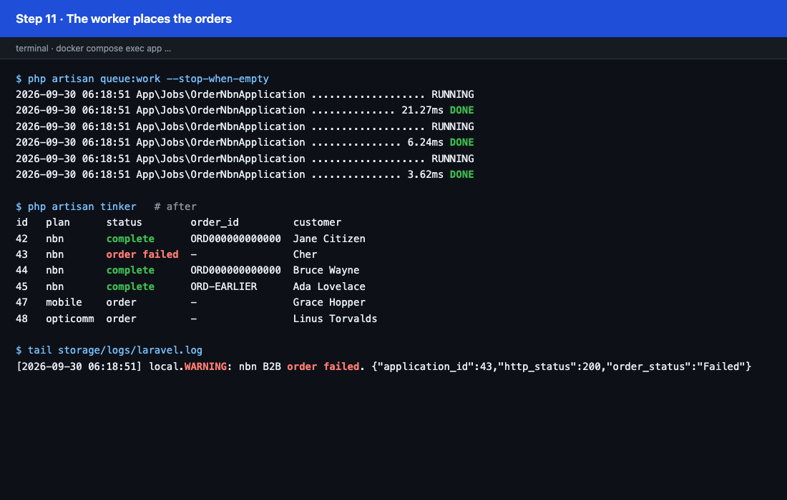

What the B2B API received: one `POST` per job, carrying exactly the six fields the task specifies.

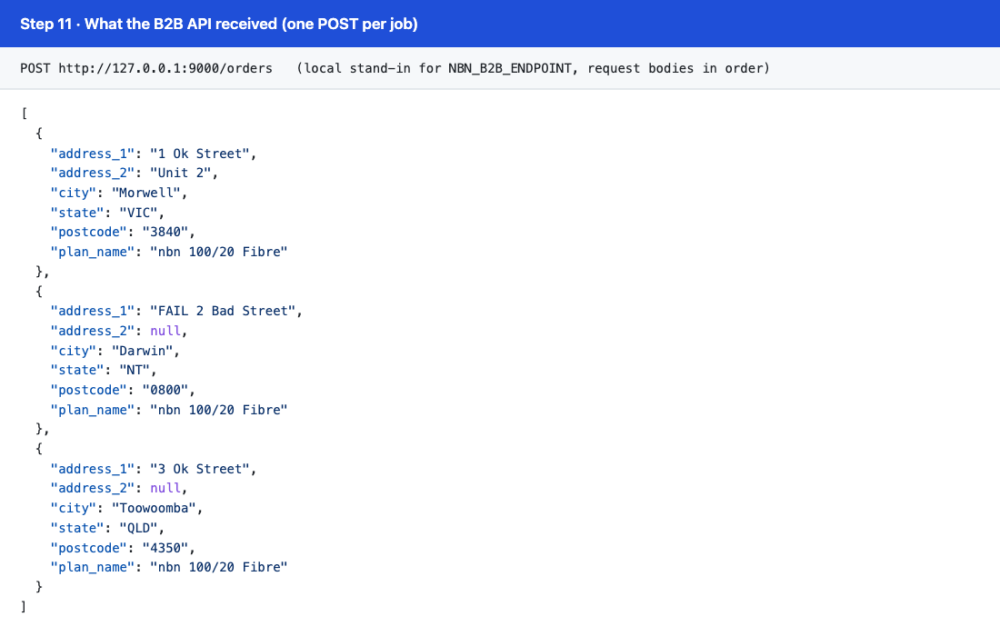

```json
[
  {
    "address_1": "1 Ok Street",
    "address_2": "Unit 2",
    "city": "Morwell",
    "state": "VIC",
    "postcode": "3840",
    "plan_name": "nbn 100/20 Fibre"
  },
  {
    "address_1": "FAIL 2 Bad Street",
    "address_2": null,
    "city": "Darwin",
    "state": "NT",
    "postcode": "0800",
    "plan_name": "nbn 100/20 Fibre"
  },
  {
    "address_1": "3 Ok Street",
    "address_2": null,
    "city": "Toowoomba",
    "state": "QLD",
    "postcode": "4350",
    "plan_name": "nbn 100/20 Fibre"
  }
]
```

The log entry for the failed order, exactly as written to `storage/logs/laravel.log`:

```
[2026-09-30 06:18:51] local.WARNING: nbn B2B order failed. {"application_id":43,"http_status":200,"order_status":"Failed"}
```

Its context, pretty-printed:

```json
{
  "application_id": 43,
  "http_status": 200,
  "order_status": "Failed"
}
```

Note that the fail stub arrives with HTTP **200**. The job treats any body whose `status` is not `Successful` as a failure, not only non-2xx responses.

### Step 12 · Back in the Task 1 API

The same `?plan_type=nbn` request as step 4. Jane and Bruce now carry `order_id` (highlighted). Cher, now `order failed`, does not, because `order_id` only appears on `complete` applications.

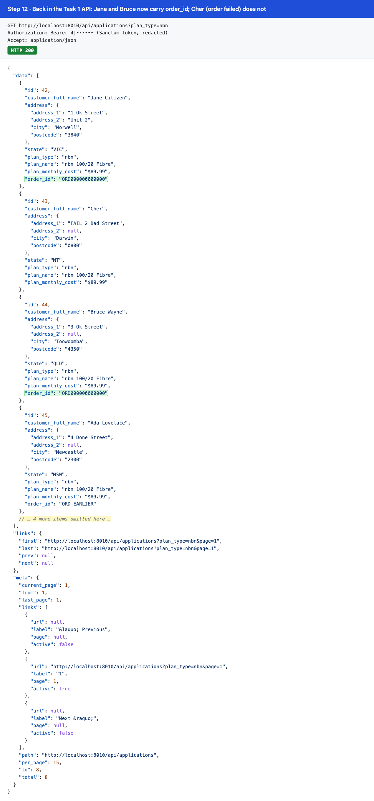

<details><summary>Response</summary>

```jsonc
{
  "data": [
    {
      "id": 42,
      "customer_full_name": "Jane Citizen",
      "address": { "address_1": "1 Ok Street", "address_2": "Unit 2", "city": "Morwell", "postcode": "3840" },
      "state": "VIC",
      "plan_type": "nbn",
      "plan_name": "nbn 100/20 Fibre",
      "plan_monthly_cost": "$89.99",
      "order_id": "ORD000000000000"
    },
    {
      "id": 43,
      "customer_full_name": "Cher",
      "address": { "address_1": "FAIL 2 Bad Street", "address_2": null, "city": "Darwin", "postcode": "0800" },
      "state": "NT",
      "plan_type": "nbn",
      "plan_name": "nbn 100/20 Fibre",
      "plan_monthly_cost": "$89.99"
    },
    {
      "id": 44,
      "customer_full_name": "Bruce Wayne",
      "address": { "address_1": "3 Ok Street", "address_2": null, "city": "Toowoomba", "postcode": "4350" },
      "state": "QLD",
      "plan_type": "nbn",
      "plan_name": "nbn 100/20 Fibre",
      "plan_monthly_cost": "$89.99",
      "order_id": "ORD000000000000"
    },
    {
      "id": 45,
      "customer_full_name": "Ada Lovelace",
      "address": { "address_1": "4 Done Street", "address_2": null, "city": "Newcastle", "postcode": "2300" },
      "state": "NSW",
      "plan_type": "nbn",
      "plan_name": "nbn 100/20 Fibre",
      "plan_monthly_cost": "$89.99",
      "order_id": "ORD-EARLIER"
    },
    // … 4 more items omitted here …
  ],
  "links": {
    "first": "http://localhost:8010/api/applications?plan_type=nbn&page=1",
    "last": "http://localhost:8010/api/applications?plan_type=nbn&page=1",
    "prev": null,
    "next": null
  },
  "meta": {
    "current_page": 1,
    "from": 1,
    "last_page": 1,
    "links": [
      { "url": null, "label": "&laquo; Previous", "page": null, "active": false },
      { "url": "http://localhost:8010/api/applications?plan_type=nbn&page=1", "label": "1", "page": 1, "active": true },
      { "url": null, "label": "Next &raquo;", "page": null, "active": false }
    ],
    "path": "http://localhost:8010/api/applications",
    "per_page": 15,
    "to": 8,
    "total": 8
  }
}
```

</details>

---

## Reproducing this walkthrough

The app ran on port 8010 for this walkthrough because 8000 was taken on the machine; `compose.yaml` serves on 8000 by default. Adjust the URLs to match.

1. `docker compose up`, then create data with the factories in `php artisan tinker`. The table in [Demo data](#demo-data) lists the rows used.
2. Create a token for the seeded user: `User::where('email', 'test@example.com')->first()->createToken('demo')->plainTextToken`.
3. Call the API with `Authorization: Bearer <token>` and `Accept: application/json`, for example with `curl -H "Authorization: Bearer <token>" -H "Accept: application/json" "http://localhost:8000/api/applications?plan_type=nbn"`.
4. For Task 2, start a local stand-in for the B2B API inside the container that returns `tests/stubs/nbn-successful-response.json` or `nbn-fail-response.json`. Then run the command and the worker with the endpoint pointing at it:

   ```
   docker compose exec -e NBN_B2B_ENDPOINT=http://127.0.0.1:9000/orders app php artisan applications:order-nbn
   docker compose exec -e NBN_B2B_ENDPOINT=http://127.0.0.1:9000/orders app php artisan queue:work --stop-when-empty
   ```
